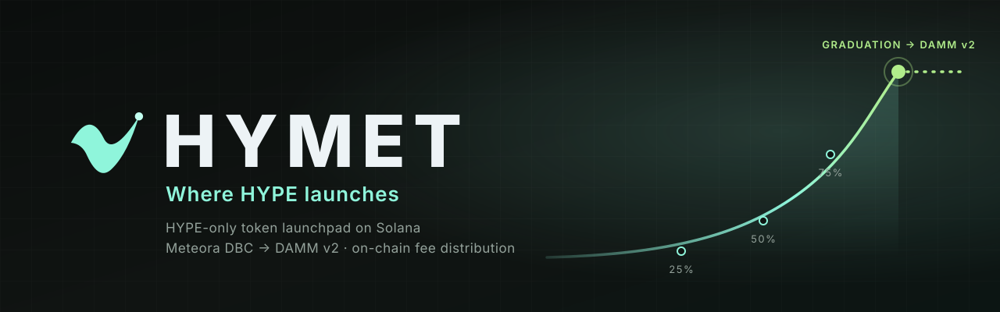

  

  <b>HYMET is a HYPE-only token launchpad on Solana.</b> 
  Fixed-supply launches on a Meteora bonding curve, automatic graduation to permanently locked DAMM v2 liquidity,
  and trading fees shared on-chain with creators and holders.

  
  
  

---

### What we build

| | |
|---|---|
| 🚀 **Launch** | One fixed recipe for every token: 1B supply, HYPE quote, 33.5 → 447 HYPE market-cap curve, 0.25–3% fee |
| 🎓 **Graduate** | At 96.07 HYPE raised the curve migrates to Meteora DAMM v2, with 100% of the liquidity permanently locked |
| 💸 **Share** | 20% of trading fees to HYMET; the rest to the creator, or split between the creator and holders and pushed to holders automatically |
| 🔍 **Verify** | Every address pinned, every transaction reviewed byte for byte before it is sent, and a reproducible program build |

### Repositories

| Repository | What's inside |
|---|---|
| [**hymet**](https://github.com/Hymetdotfun/hymet) | The platform: web app, API, keeper, indexer, database schema, program source and documentation |
| [**hymet-distributor**](https://github.com/Hymetdotfun/hymet-distributor) | The on-chain fee distributor with its history, for auditing and build verification |

### On-chain

| | |
|---|---|
| Distributor program | [`9X9fnj4Uh9WC9nmxCahTVsixHZ6VGxNpMesuGhK239Px`](https://solscan.io/account/9X9fnj4Uh9WC9nmxCahTVsixHZ6VGxNpMesuGhK239Px) |
| Program binary SHA-256 | `fda10de4da728442da4a42a63bb1f5d8df614e49f8421c656ee2ca67f3be3e7b` |
| HYPE | [`98sMhvDwXj1RQi5c5Mndm3vPe9cBqPrbLaufMXFNMh5g`](https://solscan.io/token/98sMhvDwXj1RQi5c5Mndm3vPe9cBqPrbLaufMXFNMh5g) |

Security reports: please use private vulnerability reporting on the relevant repository. Nothing here is
financial advice.
